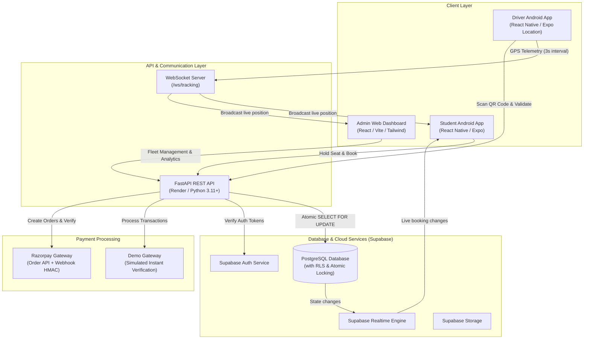

# LPU GoCart – System Architecture & Data Flow

---

### Component Breakdown

#### 1. Backend Service (FastAPI)
- **Role**: Core business engine and gatekeeper.
- **Key Modules**:
  - `core/`: Application settings, JWT decoding, security helpers, and dependency injection.
  - `services/seat_lock_service.py`: Enforces atomic transactions so that only one student can hold a given seat during checkout.
  - `services/booking_service.py`: Orchestrates ticket generation, status transitions (`PENDING` -> `CONFIRMED` -> `BOARDED`), and seat liberation.
  - `gateways/payments/`: Dynamic gateway interface (`BasePaymentGateway`) with pluggable implementations (`DemoPaymentGateway` and `RazorpayPaymentGateway`).
  - `websockets/tracking.py`: In-memory broadcast hub streaming GPS coordinates to connected students and admin monitors.

#### 2. Mobile Applications (React Native & Expo)
- **Student App**: Focuses on frictionless discovery. Shows an interactive OpenStreetMap view of LPU campus, lists active carts, illustrates a dynamic 2x4 seat grid, facilitates instant reservation, and yields an offline-accessible boarding QR code.
- **Driver App**: Streamlined, high-contrast UI tailored for driving conditions. Runs background/foreground GPS location tracking using Expo Location and features a built-in camera QR scanner to confirm passenger boarding.

#### 3. Administrative Console (React + Vite)
- **Role**: Real-time fleet oversight.
- **Features**: Live Leaflet map displaying moving cart markers, CCTV health monitors, driver performance analytics, route configuration, and automated revenue reconciliation.
