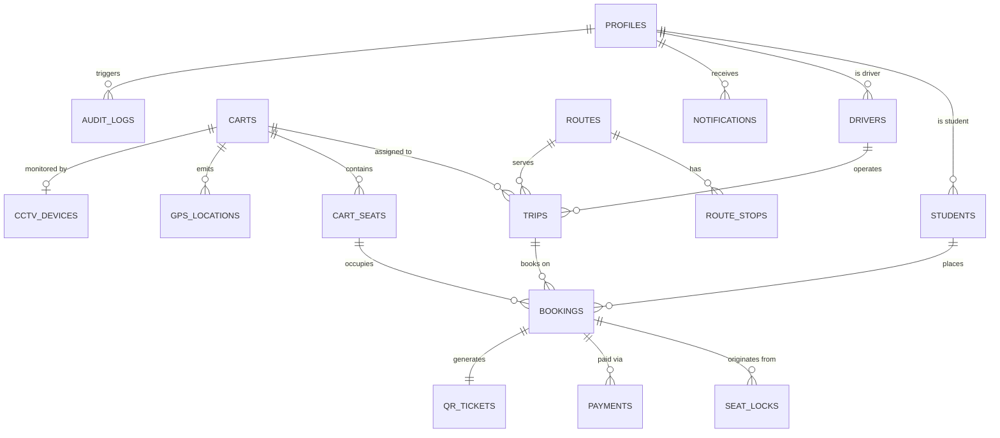

# LPU GoCart – Supabase Database Schema Documentation

The system utilizes PostgreSQL hosted on Supabase. All primary keys use `UUIDv4`. All tables enforce `created_at` and `updated_at` triggers and Row Level Security (RLS).

---

### Entity Relationship Model

---

### Detailed Table Specifications

#### 1. `profiles`
Central user registry linked to Supabase `auth.users`.
- `id` (UUID, PK, References `auth.users.id` ON DELETE CASCADE)
- `email` (TEXT, UNIQUE, NOT NULL)
- `full_name` (TEXT, NOT NULL)
- `phone_number` (VARCHAR(15))
- `role` (VARCHAR(20), CHECK IN ('STUDENT', 'DRIVER', 'ADMIN'), DEFAULT 'STUDENT')
- `avatar_url` (TEXT)
- `created_at` (TIMESTAMPTZ, DEFAULT NOW())
- `updated_at` (TIMESTAMPTZ, DEFAULT NOW())

#### 2. `students`
Student profile extensions.
- `id` (UUID, PK, References `profiles.id` ON DELETE CASCADE)
- `registration_number` (VARCHAR(20), UNIQUE, NOT NULL) - e.g. "12104567"
- `department` (VARCHAR(100))
- `hostel_block` (VARCHAR(50))
- `created_at` (TIMESTAMPTZ, DEFAULT NOW())

#### 3. `drivers`
Driver licensing and status.
- `id` (UUID, PK, References `profiles.id` ON DELETE CASCADE)
- `license_number` (VARCHAR(50), UNIQUE, NOT NULL)
- `is_available` (BOOLEAN, DEFAULT TRUE)
- `assigned_cart_id` (UUID, References `carts.id` ON DELETE SET NULL)
- `created_at` (TIMESTAMPTZ, DEFAULT NOW())

#### 4. `carts`
Physical electric carts operating on campus.
- `id` (UUID, PK, DEFAULT gen_random_uuid())
- `cart_number` (VARCHAR(20), UNIQUE, NOT NULL) - e.g. "LPU-CART-01"
- `model` (VARCHAR(50), DEFAULT 'Club Car Transporter 8')
- `total_seats` (INTEGER, DEFAULT 8, CHECK (total_seats > 0 AND total_seats <= 14))
- `battery_percentage` (INTEGER, DEFAULT 100, CHECK (battery_percentage BETWEEN 0 AND 100))
- `status` (VARCHAR(20), DEFAULT 'ACTIVE', CHECK IN ('ACTIVE', 'MAINTENANCE', 'OFFLINE', 'CHARGING'))
- `current_route_id` (UUID, References `routes.id` ON DELETE SET NULL)
- `has_cctv` (BOOLEAN, DEFAULT FALSE)
- `created_at` (TIMESTAMPTZ, DEFAULT NOW())

#### 5. `routes`
Defined campus shuttle paths.
- `id` (UUID, PK, DEFAULT gen_random_uuid())
- `name` (VARCHAR(100), NOT NULL) - e.g. "Main Gate - UniMall Express"
- `code` (VARCHAR(20), UNIQUE, NOT NULL) - e.g. "ROUTE-A"
- `description` (TEXT)
- `fare_amount` (DECIMAL(6,2), DEFAULT 10.00, NOT NULL)
- `is_active` (BOOLEAN, DEFAULT TRUE)
- `created_at` (TIMESTAMPTZ, DEFAULT NOW())

#### 6. `route_stops`
Geocoded waypoints along each route.
- `id` (UUID, PK, DEFAULT gen_random_uuid())
- `route_id` (UUID, NOT NULL, References `routes.id` ON DELETE CASCADE)
- `name` (VARCHAR(100), NOT NULL) - e.g. "Central Library"
- `latitude` (DECIMAL(10,8), NOT NULL)
- `longitude` (DECIMAL(11,8), NOT NULL)
- `sequence_order` (INTEGER, NOT NULL)
- `estimated_minutes` (INTEGER, DEFAULT 2)
- CONSTRAINT `unique_route_stop_order` UNIQUE (`route_id`, `sequence_order`)

#### 7. `cart_seats`
Individual bookable seats inside a cart.
- `id` (UUID, PK, DEFAULT gen_random_uuid())
- `cart_id` (UUID, NOT NULL, References `carts.id` ON DELETE CASCADE)
- `seat_number` (INTEGER, NOT NULL)
- `seat_label` (VARCHAR(10), NOT NULL) - e.g. "S1", "S2"
- `is_accessible` (BOOLEAN, DEFAULT FALSE)
- CONSTRAINT `unique_cart_seat` UNIQUE (`cart_id`, `seat_number`)

#### 8. `trips`
Active and historical journey runs.
- `id` (UUID, PK, DEFAULT gen_random_uuid())
- `cart_id` (UUID, NOT NULL, References `carts.id`)
- `driver_id` (UUID, NOT NULL, References `drivers.id`)
- `route_id` (UUID, NOT NULL, References `routes.id`)
- `status` (VARCHAR(20), DEFAULT 'SCHEDULED', CHECK IN ('SCHEDULED', 'IN_TRANSIT', 'COMPLETED', 'CANCELLED'))
- `started_at` (TIMESTAMPTZ)
- `completed_at` (TIMESTAMPTZ)
- `created_at` (TIMESTAMPTZ, DEFAULT NOW())

#### 9. `seat_locks`
Transient 5-minute atomic holds created before checkout.
- `id` (UUID, PK, DEFAULT gen_random_uuid())
- `trip_id` (UUID, NOT NULL, References `trips.id` ON DELETE CASCADE)
- `seat_id` (UUID, NOT NULL, References `cart_seats.id` ON DELETE CASCADE)
- `student_id` (UUID, NOT NULL, References `students.id`)
- `locked_at` (TIMESTAMPTZ, DEFAULT NOW())
- `expires_at` (TIMESTAMPTZ, NOT NULL)
- `is_released` (BOOLEAN, DEFAULT FALSE)
- CONSTRAINT `unique_active_seat_lock` UNIQUE (`trip_id`, `seat_id`, `is_released`)

#### 10. `bookings`
Official passenger reservations.
- `id` (UUID, PK, DEFAULT gen_random_uuid())
- `booking_code` (VARCHAR(16), UNIQUE, NOT NULL) - e.g. "LPU-BK-982341"
- `student_id` (UUID, NOT NULL, References `students.id`)
- `trip_id` (UUID, NOT NULL, References `trips.id`)
- `seat_id` (UUID, NOT NULL, References `cart_seats.id`)
- `pickup_stop_id` (UUID, NOT NULL, References `route_stops.id`)
- `drop_stop_id` (UUID, NOT NULL, References `route_stops.id`)
- `fare_amount` (DECIMAL(6,2), NOT NULL)
- `status` (VARCHAR(20), DEFAULT 'PENDING', CHECK IN ('PENDING', 'CONFIRMED', 'BOARDED', 'CANCELLED', 'EXPIRED'))
- `created_at` (TIMESTAMPTZ, DEFAULT NOW())
- `updated_at` (TIMESTAMPTZ, DEFAULT NOW())
- CONSTRAINT `unique_trip_seat_confirmed` UNIQUE (`trip_id`, `seat_id`, `status`) WHERE status IN ('CONFIRMED', 'BOARDED')

#### 11. `payments`
Financial transaction records.
- `id` (UUID, PK, DEFAULT gen_random_uuid())
- `booking_id` (UUID, NOT NULL, References `bookings.id`)
- `student_id` (UUID, NOT NULL, References `students.id`)
- `amount` (DECIMAL(8,2), NOT NULL)
- `currency` (VARCHAR(3), DEFAULT 'INR')
- `gateway` (VARCHAR(20), NOT NULL) - 'demo' or 'razorpay'
- `gateway_order_id` (VARCHAR(100))
- `gateway_payment_id` (VARCHAR(100))
- `status` (VARCHAR(20), DEFAULT 'PENDING', CHECK IN ('PENDING', 'COMPLETED', 'FAILED', 'REFUNDED'))
- `created_at` (TIMESTAMPTZ, DEFAULT NOW())
- `completed_at` (TIMESTAMPTZ)

#### 12. `gps_locations`
High-resolution telemetry logged during journeys.
- `id` (BIGSERIAL, PK)
- `cart_id` (UUID, NOT NULL, References `carts.id`)
- `driver_id` (UUID, NOT NULL, References `drivers.id`)
- `trip_id` (UUID, References `trips.id`)
- `latitude` (DECIMAL(10,8), NOT NULL)
- `longitude` (DECIMAL(11,8), NOT NULL)
- `speed_kph` (DECIMAL(5,2), DEFAULT 0.0)
- `heading` (DECIMAL(5,2))
- `accuracy_meters` (DECIMAL(6,2))
- `recorded_at` (TIMESTAMPTZ, NOT NULL, DEFAULT NOW())

#### 13. `qr_tickets`
Cryptographically signed digital boarding passes.
- `id` (UUID, PK, DEFAULT gen_random_uuid())
- `booking_id` (UUID, UNIQUE, NOT NULL, References `bookings.id`)
- `qr_token` (TEXT, UNIQUE, NOT NULL)
- `is_used` (BOOLEAN, DEFAULT FALSE)
- `scanned_at` (TIMESTAMPTZ)
- `scanned_by_driver_id` (UUID, References `drivers.id`)
- `created_at` (TIMESTAMPTZ, DEFAULT NOW())

#### 14. `cctv_devices`
Hardware metadata for onboard safety cameras.
- `id` (UUID, PK, DEFAULT gen_random_uuid())
- `cart_id` (UUID, UNIQUE, NOT NULL, References `carts.id`)
- `device_serial` (VARCHAR(100), UNIQUE, NOT NULL)
- `stream_url` (TEXT)
- `is_online` (BOOLEAN, DEFAULT FALSE)
- `last_heartbeat` (TIMESTAMPTZ)
- `created_at` (TIMESTAMPTZ, DEFAULT NOW())

#### 15. `notifications`
In-app and push notification audit trail.
- `id` (UUID, PK, DEFAULT gen_random_uuid())
- `recipient_id` (UUID, NOT NULL, References `profiles.id`)
- `title` (VARCHAR(150), NOT NULL)
- `message` (TEXT, NOT NULL)
- `is_read` (BOOLEAN, DEFAULT FALSE)
- `created_at` (TIMESTAMPTZ, DEFAULT NOW())

#### 16. `audit_logs`
System security and administrative action ledger.
- `id` (BIGSERIAL, PK)
- `actor_id` (UUID, References `profiles.id`)
- `action` (VARCHAR(100), NOT NULL)
- `entity_type` (VARCHAR(50), NOT NULL)
- `entity_id` (VARCHAR(50))
- `metadata` (JSONB)
- `ip_address` (VARCHAR(45))
- `created_at` (TIMESTAMPTZ, DEFAULT NOW())
